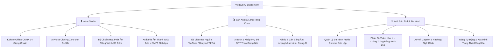

# VietDub AI Studio v2.0

<p align="center">
  
</p>

<p align="center">
  <strong>Không gian sản xuất video AI, huấn luyện giọng nói (Voice Cloning) và tự động hoá xuất bản TikTok đa kênh chuyên nghiệp.</strong>
</p>

<p align="center">
  <a href="https://github.com/khaihoansk86-debug/Vietdub-Ai/releases/latest"></a>
  
  
  
</p>

---

## 📥 Tải & Cài Đặt Nhanh

Phiên bản chính thức: **v2.0.0**

| Tệp cài đặt | Nền tảng | Dung lượng | SHA-256 Checksum |
| :--- | :---: | :---: | :--- |
| **[VietDub-AI-Setup-2.0.0.exe](https://github.com/khaihoansk86-debug/Vietdub-Ai/releases/download/v2.0.0/VietDub-AI-Setup-2.0.0.exe)** | Windows 10/11 (x64) | ~142 MB | `ED6E51BDAC08AE7483A4CA3F6776A9396430D3A2C71D7100A213A9D7835E128B` |

> [!NOTE]
> Ứng dụng đã đóng gói sẵn Node.js runtime, Electron, FFmpeg và yt-dlp. Khi sử dụng tính năng **Voice Studio Offline**, ứng dụng sẽ tự động đồng bộ và quản lý máy chủ Kokoro ONNX chạy cục bộ trên máy tính của bạn (cổng `8889`), hoàn toàn riêng tư và không tốn phí API.

---

## 🌟 Ba Trụ Cột Tính Năng Cốt Lõi



### 1. 🎙️ Voice Studio — AI Voice Cloning & Studio TTS
- **Engine Kokoro Offline ONNX:** Chạy trực tiếp trên CPU/GPU máy tính với tốc độ cao, độ trễ cực thấp, không phụ thuộc vào kết nối mạng hay phí dịch vụ bên ngoài.
- **14 Giọng Đọc Chuẩn 3 Miền:** Hỗ trợ đầy đủ các sắc thái giọng đọc Bắc - Trung - Nam, từ trầm ấm, truyền cảm, đến hoạt bát, năng động.
- **AI Voice Cloning:** Trích xuất âm sắc từ file mẫu 5s – 30s và tạo hồ sơ giọng AI riêng biệt, tự động đồng bộ và sử dụng xuyên suốt toàn bộ ứng dụng.
- **Chuẩn Hoá Ngữ Âm & Số Tiếng Việt Cấp Chuyên Gia:**
  - Khắc phục triệt để lỗi SEA-G2P phát âm sai các từ đồng âm không dấu (`to lớn`, `tự do`, `so sánh`, `ăn no`, `quả me`, `be bé`...).
  - Tự động chuyển đổi số đếm, phần trăm (`100%` → `một trăm phần trăm`), tiền tệ (`50k`, `100tr`, `đô la`), số thập phân (`1.5` → `một phẩy năm`) và từ viết tắt (`TP.HCM`, `BS.`, `ĐH`).
- **Định Dạng Âm Thanh Phòng Thu:** Hỗ trợ xuất file `.WAV` (Phòng thu 24kHz chuẩn ONNX) và `.MP3` (320kbps High Quality).

### 2. 🎬 Sản Xuất & Lồng Tiếng Video Tự Động
- **Tải Video Đa Nền Tảng:** Tự động tải video chất lượng cao từ YouTube, TikTok, Douyin thông qua yt-dlp tích hợp sẵn.
- **Nhận Diện & Dịch Phụ Đề Bằng AI:** Tận dụng sức mạnh của Google Gemini API để tạo phụ đề gốc, dịch đa ngôn ngữ sang tiếng Việt tự nhiên và giữ đúng cấu trúc câu.
- **Đồng Bộ Giọng Đọc Theo Thời Gian Thực:** Tự động căn chỉnh tốc độ đọc của AI để khớp từng mili-giây với timeline phụ đề, xử lý fade-in/fade-out nhạc nền thông minh.
- **Tuỳ Biến Giao Diện Video:** Hỗ trợ chèn logo/watermark thương hiệu, căn chỉnh vị trí phụ đề, đổi tỷ lệ khung hình (16:9, 9:16).

### 3. 🚀 Xuất Bản TikTok Đa Kênh (1:1 Direct Publisher)
- **Quản Lý Nhiều Kênh An Toàn:** Mỗi kênh vận hành trên một User Data Profile riêng biệt của Chrome, không lộ thông tin đăng nhập chéo và không bị khóa phiên.
- **Chiến Lược Phân Bổ 1:1 Tuyệt Đối:** Mỗi kênh chỉ nhận duy nhất một video từ kho nguồn trong mỗi đợt đăng. Cơ chế băm SHA-256 toàn file ngăn chặn hoàn toàn rủi ro đăng trùng lặp video.
- **AI Soạn Caption & Hashtag Ngữ Cảnh Độc Lập:** Tự động tạo caption hấp dẫn bám sát chủ đề prompt của người dùng, phân tích tránh trùng lặp 7 từ mở đầu giữa các kênh.
- **Quy Trình Xác Minh Đăng Bài Chặt Chẽ:** Tự động theo dõi tiến trình tải lên, gửi form, vượt qua bước kiểm duyệt bản quyền âm thanh và xác minh trạng thái **Đã Công Khai** trước khi ghi nhận hoàn tất.

---

## 🗣️ Danh Sách 14 Giọng Đọc Kokoro Offline Tích Hợp Sẵn

| Tên Giọng | Vùng Miền / Phong Cách | Đặc Điểm |
| :--- | :--- | :--- |
| `diem_trinh` | Nam Bộ | Ngọt ngào, nhẹ nhàng, truyền cảm |
| `manh_dung` | Bắc Bộ | Trầm ấm, uy lực, giọng kể chuyện / phóng sự |
| `minh_khoi` | Bắc Bộ | Trẻ trung, tự tin, chuyên review sản phẩm |
| `le_trinh` | Nam Bộ | Nhẹ nhàng, êm dịu, giọng đọc truyện đêm |
| `thao_nhi` | Nam Bộ | Tươi vui, tự nhiên, review & vlog đời sống |
| `mai_lan` | Bắc Bộ | Tự nhiên, rõ ràng, tin tức & tài liệu |
| `viet_bach` | Bắc Bộ | Hào sảng, cuốn hút, đọc kịch bản sôi động |
| `bao_trung` | Nam Bộ | Thân thiện, chân thật, tin cậy |
| `ha_an` | Trung Bộ | Tự nhiên, trầm ấm, mộc mạc |
| `thu_hang` | Bắc Bộ | Trong trẻo, thanh lịch, kể chuyện |
| `duc_anh` | Bắc Bộ | Chững chạc, đĩnh đạc, thuyết minh |
| `van_khoa` | Nam Bộ | Tự tin, phóng khoáng, review công nghệ |
| `thanh_thao` | Bắc Bộ | Hoạt bát, năng động, hướng dẫn ngắn |
| `hoang_long` | Nam Bộ | Trầm ấm, truyền cảm, tâm sự & podcast |

---

## 🛠️ Yêu Cầu Hệ Thống

- **Hệ điều hành:** Windows 10 hoặc Windows 11 (64-bit).
- **Phần cứng đề xuất:**
  - CPU: Intel Core i5 / AMD Ryzen 5 trở lên.
  - RAM: Tối thiểu 8 GB (Đề xuất 16 GB khi xử lý video và voice song song).
  - Ổ cứng: 2 GB dung lượng trống (SSD để tối ưu tốc độ render và load model).
- **Phần mềm bổ trợ:**
  - Google Chrome (bản mới nhất) để phục vụ tính năng đăng video TikTok tự động.
  - Khóa API Google Gemini (miễn phí) cấu hình tại mục **Cài đặt & API**.

---

## 🚀 Hướng Dẫn Phát Triển (Dành Cho Lập Trình Viên)

```bash
# 1. Clone repository
git clone https://github.com/khaihoansk86-debug/Vietdub-Ai.git
cd Vietdub-Ai

# 2. Cài đặt các gói phụ thuộc
npm install

# 3. Khởi chạy ứng dụng ở chế độ Desktop
npm run desktop

# 4. Kiểm tra mã nguồn & chạy kiểm thử tự động
npm run check
npm test

# 5. Đóng gói bộ cài Windows mới
npm run build:win
```

---

## 📄 Bản Quyền & Giấy Phép

Dự án được phát triển và vận hành bởi **VietDub AI Team**. Mọi quyền được bảo lưu.
